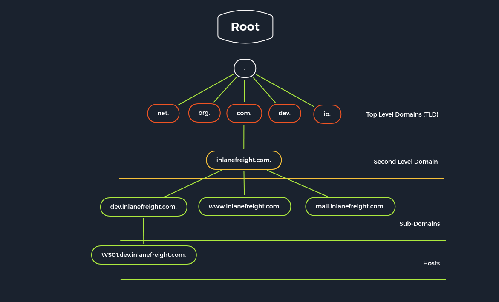

# DNS

`Domain Name System` (`DNS`) is an integral part of the Internet. For example, through domain names, such as [academy.hackthebox.com](https://academy.hackthebox.com/) or [www.hackthebox.com](https://www.hackthebox.eu/), we can reach the web servers that the hosting provider has assigned one or more specific IP addresses. DNS is a system for resolving computer names into IP addresses, and it does not have a central database. Simplified, we can imagine it like a library with many different phone books. The information is distributed over many thousands of name servers. Globally distributed DNS servers translate domain names into IP addresses and thus control which server a user can reach via a particular domain. There are several types of DNS servers that are used worldwide:

| **Server Type** | **Description** |
| --- | --- |
| `DNS Root Server` | The root servers of the DNS are responsible for the top-level domains (`TLD`). As the last instance, they are only requested if the name server does not respond. Thus, a root server is a central interface between users and content on the Internet, as it links domain and IP address. The [Internet Corporation for Assigned Names and Numbers](https://www.icann.org/) (`ICANN`) coordinates the work of the root name servers. There are `13` such root servers around the globe. |
| `Authoritative Nameserver` | Authoritative name servers hold authority for a particular zone. They only answer queries from their area of responsibility, and their information is binding. If an authoritative name server cannot answer a client's query, the root name server takes over at that point. Based on the country, company, etc., authoritative nameservers provide answers to recursive DNS nameservers, assisting in finding the specific web server(s). |
| `Non-authoritative Nameserver` | Non-authoritative name servers are not responsible for a particular DNS zone. Instead, they collect information on specific DNS zones themselves, which is done using recursive or iterative DNS querying. |
| `Caching DNS Server` | Caching DNS servers cache information from other name servers for a specified period. The authoritative name server determines the duration of this storage. |
| `Forwarding Server` | Forwarding servers perform only one function: they forward DNS queries to another DNS server. |
| `Resolver` | Resolvers are not authoritative DNS servers but perform name resolution locally in the computer or router. |

DNS is mainly unencrypted. Devices on the local WLAN and Internet providers can therefore hack in and spy on DNS queries. Since this poses a privacy risk, there are now some solutions for DNS encryption. By default, IT security professionals apply `DNS over TLS` (`DoT`) or `DNS over HTTPS` (`DoH`) here. In addition, the network protocol `DNSCrypt` also encrypts the traffic between the computer and the name server



Different `DNS records` are used for the DNS queries, which all have various tasks. Moreover, separate entries exist for different functions since we can set up mail servers and other servers for a domain.

| **DNS Record** | **Description** |
| --- | --- |
| `A` | Returns an IPv4 address of the requested domain as a result. |
| `AAAA` | Returns an IPv6 address of the requested domain. |
| `MX` | Returns the responsible mail servers as a result. |
| `NS` | Returns the DNS servers (nameservers) of the domain. |
| `TXT` | This record can contain various information. The all-rounder can be used, e.g., to validate the Google Search Console or validate SSL certificates. In addition, SPF and DMARC entries are set to validate mail traffic and protect it from spam. |
| `CNAME` | This record serves as an alias for another domain name. If you want the domain www.hackthebox.eu to point to the same IP as hackthebox.eu, you would create an A record for hackthebox.eu and a CNAME record for www.hackthebox.eu. |
| `PTR` | The PTR record works the other way around (reverse lookup). It converts IP addresses into valid domain names. |
| `SOA` | Provides information about the corresponding DNS zone and email address of the administrative contact. |

The `SOA` record is located in a domain's zone file and specifies who is responsible for the operation of the domain and how DNS information for the domain is managed.

DNS

```bash
Teophylus@htb[/htb]$ dig soa www.inlanefreight.com
```

The dot (.) is replaced by an at sign (@) in the email address. In this example, the email address of the administrator is `awsdns-hostmaster@amazon.com`.

# **Default Configuration**

There are many different configuration types for DNS. Therefore, we will only discuss the most important ones to illustrate better the functional principle from an administrative point of view. All DNS servers work with three different types of configuration files:

1. local DNS configuration files
2. zone files
3. reverse name resolution files

The local configuration files are usually:

- `named.conf.local`
- `named.conf.options`
- `named.conf.log`

### **Local DNS Configuration**

DNS

```bash
root@bind9:~# cat /etc/bind/named.conf.local

//
// Do any local configuration here
//

// Consider adding the 1918 zones here, if they are not used in your
// organization
//include "/etc/bind/zones.rfc1918";
zone "domain.com" {
    type master;
    file "/etc/bind/db.domain.com";
    allow-update { key rndc-key; };
};
```

A `zone file` is a text file that describes a DNS zone with the BIND file format. In other words it is a point of delegation in the DNS tree. The BIND file format is the industry-preferred zone file format and is now well established in DNS server software. A zone file describes a zone completely. There must be precisely one `SOA` record and at least one `NS` record. The SOA resource record is usually located at the beginning of a zone file. The main goal of these global rules is to improve the readability of zone files. A syntax error usually results in the entire zone file being considered unusable. The name server behaves similarly as if this zone did not exist. It responds to DNS queries with a `SERVFAIL` error message.

In short, here, all `forward records` are entered according to the BIND format. This allows the DNS server to identify which domain, hostname, and role the IP addresses belong to. In simple terms, this is the phone book where the DNS server looks up the addresses for the domains it is searching for.

### **Zone Files**

```bash
root@bind9:~# cat /etc/bind/db.domain.com
```

For the `Fully Qualified Domain Name` (`FQDN`) to be resolved from the IP address, the DNS server must have a reverse lookup file. In this file, the computer name (`FQDN`) is assigned to the last octet of an IP address, which corresponds to the respective host, using a PTR record. 

# **Dangerous Settings**

There are many ways in which a DNS server can be attacked. For example, a list of vulnerabilities targeting the BIND9 server can be found at [CVEdetails](https://www.cvedetails.com/product/144/ISC-Bind.html?vendor_id=64). In addition, SecurityTrails provides a short [list](https://web.archive.org/web/20250329174745/https://securitytrails.com/blog/most-popular-types-dns-attacks) of the most popular attacks on DNS servers.

| **Option** | **Description** |
| --- | --- |
| `allow-query` | Defines which hosts are allowed to send requests to the DNS server. |
| `allow-recursion` | Defines which hosts are allowed to send recursive requests to the DNS server. |
| `allow-transfer` | Defines which hosts are allowed to receive zone transfers from the DNS server. |
| `zone-statistics` | Collects statistical data of zones. |

# **Footprinting the Service**

The footprinting at DNS servers is done as a result of the requests we send. So, first of all, the DNS server can be queried as to which other name servers are known. We do this using the NS record and the specification of the DNS server we want to query using the `@` character. This is because if there are other DNS servers, we can also use them and query the records. However, other DNS servers may be configured differently and, in addition, may be permanent for other zones.

### **DIG - NS Query**

```bash
Teophylus@htb[/htb]$ dig ns inlanefreight.htb @10.129.14.128
```

### **DIG - Version Query**

```bash
Teophylus@htb[/htb]$ dig CH TXT version.bind 10.129.120.85
```

We can use the option `ANY` to view all available records. This will cause the server to show us all available entries that it is willing to disclose. It is important to note that not all entries from the zones will be shown.

### **DIG - ANY Query**

```bash
Teophylus@htb[/htb]$ dig any inlanefreight.htb @10.129.14.128
```

`Zone transfer` refers to the transfer of zones to another server in DNS, which generally happens over TCP port 53. This procedure is abbreviated `Asynchronous Full Transfer Zone` (`AXFR`)

### **DIG - AXFR Zone Transfer**

```bash
Teophylus@htb[/htb]$ dig axfr inlanefreight.htb @10.129.14.128
```

### **DIG - AXFR Zone Transfer - Internal**

DNS

```bash
Teophylus@htb[/htb]$ dig axfr internal.inlanefreight.htb @10.129.14.128

; <<>> DiG 9.16.1-Ubuntu <<>> axfr internal.inlanefreight.htb @10.129.14.128
;; global options: +cmd
internal.inlanefreight.htb. 604800 IN   SOA     inlanefreight.htb. root.inlanefreight.htb. 2 604800 86400 2419200 604800
internal.inlanefreight.htb. 604800 IN   TXT     "MS=ms97310371"
internal.inlanefreight.htb. 604800 IN   TXT     "atlassian-domain-verification=t1rKCy68JFszSdCKVpw64A1QksWdXuYFUeSXKU"
internal.inlanefreight.htb. 604800 IN   TXT     "v=spf1 include:mailgun.org include:_spf.google.com include:spf.protection.outlook.com include:_spf.atlassian.net ip4:10.129.124.8 ip4:10.129.127.2 ip4:10.129.42.106 ~all"
internal.inlanefreight.htb. 604800 IN   NS      ns.inlanefreight.htb.
dc1.internal.inlanefreight.htb. 604800 IN A     10.129.34.16
dc2.internal.inlanefreight.htb. 604800 IN A     10.129.34.11
mail1.internal.inlanefreight.htb. 604800 IN A   10.129.18.200
ns.internal.inlanefreight.htb. 604800 IN A      10.129.34.136
vpn.internal.inlanefreight.htb. 604800 IN A     10.129.1.6
ws1.internal.inlanefreight.htb. 604800 IN A     10.129.1.34
ws2.internal.inlanefreight.htb. 604800 IN A     10.129.1.35
wsus.internal.inlanefreight.htb. 604800 IN A    10.129.18.2
internal.inlanefreight.htb. 604800 IN   SOA     inlanefreight.htb. root.inlanefreight.htb. 2
```

The individual `A` records with the hostnames can also be found out with the help of a brute-force attack. To do this, we need a list of possible hostnames, which we use to send the requests in order. Such lists are provided, for example, by [SecLists](https://github.com/danielmiessler/SecLists/blob/master/Discovery/DNS/subdomains-top1million-5000.txt).

### **Subdomain Brute Forcing**

DNS

```bash
Teophylus@htb[/htb]$ for sub in $(cat /opt/useful/seclists/Discovery/DNS/subdomains-top1million-110000.txt);do dig $sub.inlanefreight.htb @10.129.14.128 | grep -v ';\|SOA' | sed -r '/^\s*$/d' | grep $sub | tee -a subdomains.txt;done

ns.inlanefreight.htb.   604800  IN      A       10.129.34.136
mail1.inlanefreight.htb. 604800 IN      A       10.129.18.201
app.inlanefreight.htb.  604800  IN      A       10.129.18.15
```

Many different tools can be used for this, and most of them work in the same way. One of these tools is, for example [DNSenum](https://github.com/fwaeytens/dnsenum).

DNS

```bash
Teophylus@htb[/htb]$ dnsenum --dnsserver 10.129.14.128 --enum -p 0 -s 0 -o subdomains.txt -f /opt/useful/seclists/Discovery/DNS/subdomains-top1million-110000.txt inlanefreight.htb

```