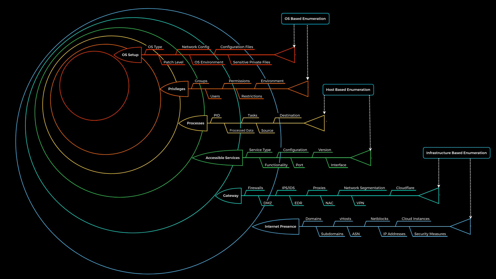

# Introduction

### **Enumeration Principles**

Enumeration is a widely used term in cyber security. It stands for information gathering using active (scans) and passive (use of third-party providers) methods. It is important to note that OSINT is an independent procedure and should be performed separately from enumeration because `OSINT is based exclusively on passive information gathering` and does not involve active enumeration of the given target

Enumeration is a loop in which we repeatedly gather information based on what data we have or have already discovered.

Information can be gathered from domains, IP addresses, accessible services, and many other sources.

Unfortunately, brute-forcing is a noisy method and can easily lead to blacklisting, making further testing impossible. Primarily, this can happen if we do not know about the company's defensive security measures and its infrastructure. Some may smile at this approach, but experience has shown that far too many testers take this type of approach.

`Our goal is not to get at the systems but to find all the ways to get there.`

| **`No.`** | **`Principle`** |
| --- | --- |
| 1. | There is more than meets the eye. Consider all points of view. |
| 2. | Distinguish between what we see and what we do not see. |
| 3. | There are always ways to gain more information. Understand the target. |
- What can we see?
- What reasons can we have for seeing it?
- What image does what we see create for us?
- What do we gain from it?
- How can we use it?
- What can we not see?
- What reasons can there be that we do not see?
- What image results for us from what we do not see?

# **Enumeration Methodology**

---

Complex processes must have a standardized methodology that helps us keep our bearings and avoid omitting any aspects by mistake

Especially with the variety of cases that the target systems can offer us, it is almost unpredictable how our approach should be designed.

Therefore, most penetration testers follow their habits and the steps they feel most comfortable and familiar with. However, this is not a standardized methodology but rather an experience-based approach.

Amethodology is presented that is nested in 6 layers and represents, metaphorically speaking, boundaries that we try to pass with the enumeration process. The whole enumeration process is divided into three different levels:

| **`Infrastructure-based enumeration`** | **`Host-based enumeration`** | **`OS-based enumeration`** |
| --- | --- | --- |

These layers are designed as follows:

| **Layer** | **Description** | **Information Categories** |
| --- | --- | --- |
| `1. Internet Presence` | Identification of internet presence and externally accessible infrastructure. | Domains, Subdomains, vHosts, ASN, Netblocks, IP Addresses, Cloud Instances, Security Measures |
| `2. Gateway` | Identify the possible security measures to protect the company's external and internal infrastructure. | Firewalls, DMZ, IPS/IDS, EDR, Proxies, NAC, Network Segmentation, VPN, Cloudflare |
| `3. Accessible Services` | Identify accessible interfaces and services that are hosted externally or internally. | Service Type, Functionality, Configuration, Port, Version, Interface |
| `4. Processes` | Identify the internal processes, sources, and destinations associated with the services. | PID, Processed Data, Tasks, Source, Destination |
| `5. Privileges` | Identification of the internal permissions and privileges to the accessible services. | Groups, Users, Permissions, Restrictions, Environment |
| `6. OS Setup` | Identification of the internal components and systems setup. | OS Type, Patch Level, Network config, OS Environment, Configuration files, sensitive private files |

All penetration tests are limited in time, but we should always keep in mind that one belief that there is nearly always a way in. Even after a four-week penetration test, we cannot say 100% that there are no more vulnerabilities. Someone who has been studying the company for months and analyzing them will most likely have a much greater understanding of the applications and structure than we were able to gain within the few weeks we spent on the assessment.

# **Layer No.1: Internet Presence**

The first layer we have to pass is the "Internet Presence" layer, where we focus on finding the targets we can investigate. If the scope in the contract allows us to look for additional hosts, this layer is even more critical than for fixed targets only. In this layer, we use different techniques to find domains, subdomains, netblocks, and many other components and information that present the presence of the company and its infrastructure on the Internet.

`The goal of this layer is to identify all possible target systems and interfaces that can be tested.`

# **Layer No.2: Gateway**

Here we try to understand the interface of the reachable target, how it is protected, and where it is located in the network. Due to the diversity, different functionalities, and some particular procedures, we will go into more detail about this layer in other modules.

`The goal is to understand what we are dealing with and what we have to watch out for.`

# **Layer No.3: Accessible Services**

In the case of accessible services, we examine each destination for all the services it offers. Each of these services has a specific purpose that has been installed for a particular reason by the administrator. Each service has certain functions, which therefore also lead to specific results. To work effectively with them, we need to know how they work. Otherwise, we need to learn to understand them.

`This layer aims to understand the reason and functionality of the target system and gain the necessary knowledge to communicate with it and exploit it for our purposes effectively.`

This is the part of enumeration we will mainly deal with in this module.

# **Layer No.4: Processes**

Every time a command or function is executed, data is processed, whether entered by the user or generated by the system. This starts a process that has to perform specific tasks, and such tasks have at least one source and one target.

`The goal here is to understand these factors and identify the dependencies between them.`

# **Layer No.5: Privileges**

Each service runs through a specific user in a particular group with permissions and privileges defined by the administrator or the system. These privileges often provide us with functions that administrators overlook. This often happens in Active Directory infrastructures and many other case-specific administration environments and servers where users are responsible for multiple administration areas.

`It is crucial to identify these and understand what is and is not possible with these privileges.`

# **Layer No.6: OS Setup**

Here we collect information about the actual operating system and its setup using internal access. This gives us a good overview of the internal security of the systems and reflects the skills and capabilities of the company's administrative teams.

`The goal here is to see how the administrators manage the systems and what sensitive internal information we can glean from them.`