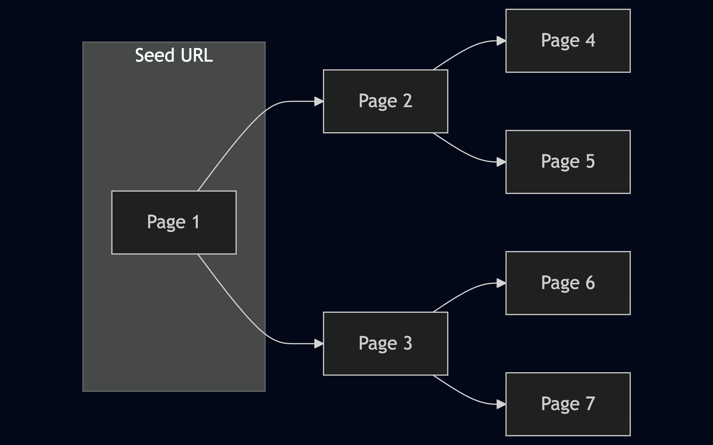

# Crawling

`Crawling`, often called `spidering`, is the `automated process of systematically browsing the World Wide Web`. Similar to how a spider navigates its web, a web crawler follows links from one page to another, collecting information. These crawlers are essentially bots that use pre-defined algorithms to discover and index web pages, making them accessible through search engines or for other purposes like data analysis and web reconnaissance.

# **How Web Crawlers Work**

The basic operation of a web crawler is straightforward yet powerful. It starts with a seed URL, which is the initial web page to crawl. The crawler fetches this page, parses its content, and extracts all its links. It then adds these links to a queue and crawls them, repeating the process iteratively. Depending on its scope and configuration, the crawler can explore an entire website or even a vast portion of the web.

1. `Homepage`: You start with the homepage containing `link1`, `link2`, and `link3`.
    
    Code: txt
    
    ```
    Homepage
    ├── link1
    ├── link2
    └── link3
    
    ```
    
2. `Visiting link1`: Visiting `link1` shows the homepage, `link2`, and also `link4` and `link5`.
    
    Code: txt
    
    ```
    link1 Page
    ├── Homepage
    ├── link2
    ├── link4
    └── link5
    
    ```
    
3. `Continuing the Crawl`: The crawler continues to follow these links systematically, gathering all accessible pages and their links.



### **Depth-First Crawling**

[Flowchart showing a Seed URL leading to Page 1, then to Page 2. Page 2 connects to Page 3, which branches to Page 4 and Page 5.](https://mermaid.ink/svg/pako:eNo9zz0PgjAQBuC_0twsg18LgwlfGyYG4uQ5VHoC0RZS2sEQ_rsnTezU98mlvXeGZlAEMbRWjp0oKzSTf4RQEylxrUo0gk9yu8iWxPaOhoxCk4goOok06I41XSELsGfIVsgDHBjyFYoAR4YivCEEGtiAJqtlr3iZ-fclgutIE0LMVyXtCwHNwnPSu6H-mAZiZz1twA6-7SB-yvfEyY9KOsp7ySX0X0n1brDn0HWtvHwB2SFOww)

In contrast, `depth-first crawling` prioritizes depth over breadth. It follows a single path of links as far as possible before backtracking and exploring other paths. This can be useful for finding specific content or reaching deep into a website's structure.

# **Extracting Valuable Information**

Crawlers can extract a diverse array of data, each serving a specific purpose in the reconnaissance process:

- `Links (Internal and External)`: These are the fundamental building blocks of the web, connecting pages within a website (`internal links`) and to other websites (`external links`). Crawlers meticulously collect these links, allowing you to map out a website's structure, discover hidden pages, and identify relationships with external resources.
- `Comments`: Comments sections on blogs, forums, or other interactive pages can be a goldmine of information. Users often inadvertently reveal sensitive details, internal processes, or hints of vulnerabilities in their comments.
- `Metadata`: Metadata refers to `data about data`. In the context of web pages, it includes information like page titles, descriptions, keywords, author names, and dates. This metadata can provide valuable context about a page's content, purpose, and relevance to your reconnaissance goals.
- `Sensitive Files`: Web crawlers can be configured to actively search for sensitive files that might be inadvertently exposed on a website. This includes `backup files` (e.g., `.bak`, `.old`), `configuration files` (e.g., `web.config`, `settings.php`), `log files` (e.g., `error_log`, `access_log`), and other files containing passwords, `API keys`, or other confidential information. Carefully examining the extracted files, especially backup and configuration files, can reveal a trove of sensitive information, such as `database credentials`, `encryption keys`, or even source code snippets.

it's essential to approach data analysis holistically, considering the relationships between different data points and their potential implications for your reconnaissance goals.

# **robots.txt**

---

Imagine you're a guest at a grand house party. While you're free to mingle and explore, there might be certain rooms marked "Private" that you're expected to avoid. This is akin to how `robots.txt` functions in the world of web crawling. It acts as a virtual "`etiquette guide`" for bots, outlining which areas of a website they are allowed to access and which are off-limits.

# **What is robots.txt?**

Technically, `robots.txt` is a simple text file placed in the root directory of a website (e.g., `www.example.com/robots.txt`). It adheres to the Robots Exclusion Standard, guidelines for how web crawlers should behave when visiting a website

This file contains instructions in the form of "directives" that tell bots which parts of the website they can and cannot crawl.

### **How robots.txt Works**

The directives in robots.txt typically target specific user-agents, which are identifiers for different types of bots. For example, a directive might look like this:

Code: txt

```
User-agent: *
Disallow: /private/
```

### **Understanding robots.txt Structure**

The robots.txt file is a plain text document that lives in the root directory of a website. It follows a straightforward structure, with each set of instructions, or "record," separated by a blank line. Each record consists of two main components:

1. `User-agent`: This line specifies which crawler or bot the following rules apply to. A wildcard () indicates that the rules apply to all bots. Specific user agents can also be targeted, such as "Googlebot" (Google's crawler) or "Bingbot" (Microsoft's crawler).
2. `Directives`: These lines provide specific instructions to the identified user-agent.

Common directives include:

| **Directive** | **Description** | **Example** |
| --- | --- | --- |
| `Disallow` | Specifies paths or patterns that the bot should not crawl. | `Disallow: /admin/` (disallow access to the admin directory) |
| `Allow` | Explicitly permits the bot to crawl specific paths or patterns, even if they fall under a broader `Disallow` rule. | `Allow: /public/` (allow access to the public directory) |
| `Crawl-delay` | Sets a delay (in seconds) between successive requests from the bot to avoid overloading the server. | `Crawl-delay: 10` (10-second delay between requests) |
| `Sitemap` | Provides the URL to an XML sitemap for more efficient crawling. | `Sitemap: https://www.example.com/sitemap.xml` |
- `Avoiding Overburdening Servers`: By limiting crawler access to certain areas, website owners can prevent excessive traffic that could slow down or even crash their servers.
- `Protecting Sensitive Information`: Robots.txt can shield private or confidential information from being indexed by search engines.
- `Legal and Ethical Compliance`: In some cases, ignoring robots.txt directives could be considered a violation of a website's terms of service or even a legal issue, especially if it involves accessing copyrighted or private data.

# **robots.txt in Web Reconnaissance**

For web reconnaissance, robots.txt serves as a valuable source of intelligence

`Uncovering Hidden Directories`: Disallowed paths in robots.txt often point to directories or files the website owner intentionally wants to keep out of reach from search engine crawlers
`Mapping Website Structure`: By analyzing the allowed and disallowed paths, security professionals can create a rudimentary map of the website's structure

`Detecting Crawler Traps`: Some websites intentionally include "honeypot" directories in robots.txt to lure malicious bots.

### **Analyzing robots.txt**

Here's an example of a robots.txt file:

Code: txt

```
User-agent: *
Disallow: /admin/
Disallow: /private/
Allow: /public/

User-agent: Googlebot
Crawl-delay: 10

Sitemap: https://www.example.com/sitemap.xml
```

By analyzing this robots.txt, we can infer that the website likely has an admin panel located at `/admin/` and some private content in the `/private/` directory.

# **Well-Known URIs**

---

The `.well-known` standard, defined in [RFC 8615](https://datatracker.ietf.org/doc/html/rfc8615), serves as a standardized directory within a website's root domain. This designated location, typically accessible via the `/.well-known/` path on a web server, centralizes a website's critical metadata, including configuration files and information related to its services, protocols, and security mechanisms.

By establishing a consistent location for such data, `.well-known` simplifies the discovery and access process for various stakeholders, including web browsers, applications, and security tools

For instance, to access a website's security policy, a client would request `https://example.com/.well-known/security.txt`.

The `Internet Assigned Numbers Authority` (`IANA`) maintains a [registry](https://www.iana.org/assignments/well-known-uris/well-known-uris.xhtml) of `.well-known` URIs, each serving a specific purpose defined by various specifications and standards. Below is a table highlighting a few notable examples:

| **URI Suffix** | **Description** | **Status** | **Reference** |
| --- | --- | --- | --- |
| `security.txt` | Contains contact information for security researchers to report vulnerabilities. | Permanent | RFC 9116 |
| `/.well-known/change-password` | Provides a standard URL for directing users to a password change page. | Provisional | https://w3c.github.io/webappsec-change-password-url/#the-change-password-well-known-uri |
| `openid-configuration` | Defines configuration details for OpenID Connect, an identity layer on top of the OAuth 2.0 protocol. | Permanent | http://openid.net/specs/openid-connect-discovery-1_0.html |
| `assetlinks.json` | Used for verifying ownership of digital assets (e.g., apps) associated with a domain. | Permanent | https://github.com/google/digitalassetlinks/blob/master/well-known/specification.md |
| `mta-sts.txt` | Specifies the policy for SMTP MTA Strict Transport Security (MTA-STS) to enhance email security. | Permanent | RFC 8461 |

`.well-known` URIs can be invaluable for discovering endpoints and configuration details that can be further tested during a penetration test. One particularly useful URI is `openid-configuration`.

The `openid-configuration` URI is part of the OpenID Connect Discovery protocol, an identity layer built on top of the OAuth 2.0 protocol. 

Code: json

```json
{
  "issuer": "https://example.com",
  "authorization_endpoint": "https://example.com/oauth2/authorize",
  "token_endpoint": "https://example.com/oauth2/token",
  "userinfo_endpoint": "https://example.com/oauth2/userinfo",
  "jwks_uri": "https://example.com/oauth2/jwks",
  "response_types_supported": ["code", "token", "id_token"],
  "subject_types_supported": ["public"],
  "id_token_signing_alg_values_supported": ["RS256"],
  "scopes_supported": ["openid", "profile", "email"]
}
```

The information obtained from the `openid-configuration` endpoint provides multiple exploration opportunities:

1. `Endpoint Discovery`:
    - `Authorization Endpoint`: Identifying the URL for user authorization requests.
    - `Token Endpoint`: Finding the URL where tokens are issued.
    - `Userinfo Endpoint`: Locating the endpoint that provides user information.
2. `JWKS URI`: The `jwks_uri` reveals the `JSON Web Key Set` (`JWKS`), detailing the cryptographic keys used by the server.
3. `Supported Scopes and Response Types`: Understanding which scopes and response types are supported helps in mapping out the functionality and limitations of the OpenID Connect implementation.
4. `Algorithm Details`: Information about supported signing algorithms can be crucial for understanding the security measures in place.