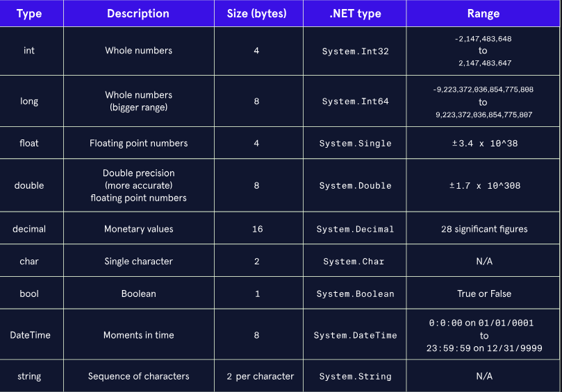

# C#

Is a general-purpose, object-oriented programming language developed by Microsoft. It is part of the .NET family of languages and is used to build a wide range of applications, from web and mobile applications to games and cloud services.

Is a statically-typed language, which means that the type of a variable must be specified when it is declared, and that the type of a value cannot be changed after it has been assigned. C# also supports object-oriented programming, which means that it provides features such as encapsulation, inheritance, and polymorphism.

Is a popular language for building .NET applications, and it is used by many large companies and organizations, including Microsoft, Dell, and IBM. It is a versatile language that can be used for a wide range of purposes, and it is well-suited for building scalable and maintainable software systems.



IConvert to other types:

```csharp
        // Explicit casting from double to int (truncates the fractional part)
        double doubleValue = 10.12;
        int intValue1 = (int)doubleValue;
// O de esta forma
        int intValue2 = Convert.ToInt32(doubleValue);  
			
			// Se puede transformar implicito pero solo si no se pierden datos. De int a double es posible pero de double a int no.
			int smallInt = 10;
      double largerDouble = smallInt;
```

Choosing a data type that takes up less memory will result in faster applications.

A *double* is usually the best choice of the three because it is more precise than a `float`, but faster to process than a *decimal*.
Make sure to use a decimal for financial applications, since it is the most precise.

To define a Decimal value, remember de m word at the end

```csharp
decimal variableName = 489872.76m;
```

- `Math.Abs()`—will find the absolute value of a number. Example: `Math.Abs(-5)` returns 5.
- `Math.Sqrt()`—will find the square root of a number. Example: `Math.Sqrt(16)` returns 4.
- `Math.Floor()`—will round the given double or decimal down to the nearest whole number. Example: `Math.Floor(8.65)` returns 8.
- `Math.Min()`—returns the smaller of two numbers. Example: `Math.Min(39, 12)` returns 12.
- `Math.Pow()` - raise a number to the other
- `Math.Max()` - finds the max number
- `Math.Ceiling()` - round the number upward

- Use the addition symbol (`+`) to concatenate strings.
- Interpolate strings for easier string construction.
- Find information about a string using [`.Length`](https://www.codecademy.com/resources/docs/c-sharp/arrays/length) and [`.IndexOf()`](https://www.codecademy.com/resources/docs/c-sharp/strings/indexof).
- Grab characters and parts of strings using bracket notation and `.Substring()`.
- Use built-in [methods](https://www.codecademy.com/resources/docs/c-sharp/methods) such as [`.ToUpper()`](https://www.codecademy.com/resources/docs/c-sharp/strings/toupper) and [`.ToLower()`](https://www.codecademy.com/resources/docs/c-sharp/strings/tolower) to manipulate strings.

Los condicionales funcionan igual que en js

```csharp
string umbrellaOrNot = isRaining ? "Umbrella" : "No Umbrella";
```

- Every time an application is started, the `Main()` method is called.
- Method parameters can be *optional* if given a default value using equals `=` syntax:

```
static void VisitPlanets(int numberOfPlanets = 0)

```

- When calling a method, pass arguments by position or by name. If using names, use the colon (`:`) syntax:

```
VisitPlanets(numberOfPlanets: 9);

```

- In *method overloading*, multiple [methods](https://www.codecademy.com/resources/docs/c-sharp/methods) can have the same name, as long as they have different method *signatures*.
- A method *signature* is a method’s name and parameter types in order.

*Expression-bodied definitions* can be used for one-line method bodies.

```
bool isEven(int num) => num % 2 == 0;

```

*Lambda expressions* can be used to create an anonymous method:

```
bool hasEvenNumbers = Array.Exists(numbers, (int num) => num % 2 == 0 );

```

You learned two “sub-shortcuts” within lambda expressions:

- You can remove the parameter type if it can be inferred:

```
bool hasEvenNumbers = Array.Exists(numbers, (num) => num % 2 == 0 );

```

- You can remove the parentheses if there is one parameter:

```
bool hasEvenNumbers = Array.Exists(numbers, num => num % 2 == 0 );

```

In general,

- `while` loops are good when you know your stopping condition, but not when you know how many times you want a program to loop or if you have a specific collection to loop through.
- `do...while` loops are only necessary if you definitely want something to run once, but then stop if a condition is met.
- `for` loops are best if you want something to run a specific number of times, rather than given a certain condition.
- `foreach` loops are the best way to loop over an array, or any other collection.

### **BREAK**

At any point within a loop block, you can end it by using the `break` keyword.

### **CONTINUE**

The `continue` keyword is used to bypass portions of code. It will ignore whatever comes after it in the loop and then will go back to the top and start the loop again.

### **RETURN**

The `return` keyword is another way to exit a loop, specifically loops that are used within a method. When a `return` is used within such a loop, it breaks out of the loop and returns control to the point in the program where the method was called.

# **C# Classes**

In C#, *classes* are used to create custom types. The class defines the kinds of information and methods included in a custom type.

# **C# Constructor**

In C#, whenever an instance of a class is created, its *constructor* is called. Like methods, a constructor can be overloaded. It must have the same name as the enclosing class. This is useful when you may want to define an additional constructor that takes a different number of arguments.

# **C# Parameterless Constructor**

In C#, if no constructors are specified in a class, the compiler automatically creates a parameterless constructor.

# **C# Access Modifiers**

In C#, members of a class can be marked with *access modifiers*, including `public` and `private`. A `public` member can be accessed by other classes. A `private` member can only be accessed by code in the same class.

By default, fields, properties, and methods are private, and classes are public.

# **C# Field**

In C#, a *field* stores a piece of data within an object. It acts like a variable and may have a different value for each instance of a type.

A field can have a number of modifiers, including: `public`, `private`, `static`, and `readonly`. If no access modifier is provided, a field is `private` by default.

# **C# this Keyword**

In C#, the `this` keyword refers to the current instance of a class.

# **C# Members**

In C#, a class contains *members*, which define the kind of data stored in a class and the behaviors a class can perform.

# **C# Dot Notation**

In C#, a member of a class can be accessed with dot notation.

# **C# Class Instance**

In C#, an object is an *instance* of a class. An object can be created from a class using the `new` keyword.

# **C# Property**

In C#, a *property* is a member of an object that controls how one field may be accessed and/or modified. A property defines two methods: a `get()` method that describes how a field can be accessed, and a `set()` method that describes how a field can be modified.

One use case for properties is to control access to a field. Another is to validate values for a field.

# **C# Auto-Implemented Property**

In C#, an *auto-implemented* property reads and writes to a private field, like other properties, but it does not require explicit definitions for the accessor methods nor the field. It is used with the `{ get; set; }` syntax. This helps your code become more concise.

# **C# Static Constructor**

In C#, a *static constructor* is run once per type, not per instance. It must be parameterless. It is invoked before the type is instantiated or a static member is accessed.

# **C# Static Class**

In C#, a *static* class cannot be instantiated. Its members are accessed by the class name.

This is useful when you want a class that provides a set of tools, but doesn’t need to maintain any internal data.

`Math` is a commonly-used static class.

```csharp
using System;

namespace StaticMembers
{
  class Forest
  {
    // FIELDS
    
    public int age;
    private string biome;
    
    // CONSTRUCTORS
    
    public Forest(string name, string biome)
    {
      this.Name = name;
      this.Biome = biome;
      Age = 0;
    }
    
    public Forest(string name) : this(name, "Unknown")
    { }
    
    // PROPERTIES
    
    public string Name
    { get; set; }
    
    public int Trees
    { get; set; }
    
    public string Biome
    {
      get { return biome; }
      set
      {
        if (value == "Tropical" ||
            value == "Temperate" ||
            value == "Boreal")
        {
          biome = value;
        }
        else
        {
          biome = "Unknown";
        }
      }
    }
    
    public int Age
    { 
      get { return age; }
      private set { age = value; }
    }
    
    // METHODS
     
    public int Grow()
    {
      Trees += 30;
      Age += 1;
      return Trees;
    }
    
    public int Burn()
    {
      Trees -= 20;
      Age += 1;
      return Trees;
    }
    
  }

}

```