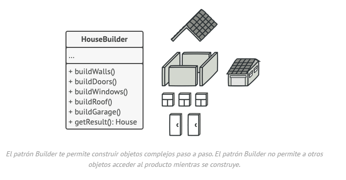

# Builder

## **Propósito**

**Builder** es un patrón de diseño creacional que nos permite construir objetos complejos paso a paso. El patrón nos permite producir distintos tipos y representaciones de un objeto empleando el mismo código de construcción.

## **Problema**

Imagina un objeto complejo que requiere una inicialización laboriosa, paso a paso, de muchos campos y objetos anidados. Normalmente, este código de inicialización está sepultado dentro de un monstruoso constructor con una gran cantidad de parámetros. O, peor aún: disperso por todo el código cliente.

## **Solución**

El patrón Builder sugiere que saques el código de construcción del objeto de su propia clase y lo coloques dentro de objetos independientes llamados *constructores*.

El patrón organiza la construcción de objetos en una serie de pasos (`construirParedes`, `construirPuerta`, etc.). Para crear un objeto, se ejecuta una serie de estos pasos en un objeto constructor. Lo importante es que no necesitas invocar todos los pasos. Puedes invocar sólo aquellos que sean necesarios para producir una configuración particular de un objeto.

## **Aplicabilidad**

**Utiliza el patrón Builder para evitar un “constructor telescópico”.**

Digamos que tenemos un constructor con diez parámetros opcionales. Invocar a semejante bestia es poco práctico, por lo que sobrecargamos el constructor y creamos varias versiones más cortas con menos parámetros. Estos constructores siguen recurriendo al principal, pasando algunos valores por defecto a cualquier parámetro omitido.

**`class** **Pizza** {
    Pizza(**int** size) { ... }
    Pizza(**int** size, **boolean** cheese) { ... }
    Pizza(**int** size, **boolean** cheese, **boolean** pepperoni) { ... }
    // ...`
*Crear un monstruo semejante sólo es posible en lenguajes que soportan la sobrecarga de métodos, como C# o Java.*

El patrón Builder permite construir objetos paso a paso, utilizando tan solo aquellos pasos que realmente necesitamos. Una vez implementado el patrón, ya no hará falta apiñar decenas de parámetros dentro de los constructores.

