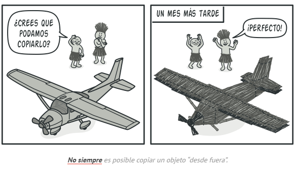

# Prototype

## **Propósito**

**Prototype** es un patrón de diseño creacional que nos permite copiar objetos existentes sin que el código dependa de sus clases.

## **Problema**

Digamos que tienes un objeto y quieres crear una copia exacta de él. ¿Cómo lo harías? En primer lugar, debes crear un nuevo objeto de la misma clase. Después debes recorrer todos los campos del objeto original y copiar sus valores en el nuevo objeto.

¡Bien! Pero hay una trampa. No todos los objetos se pueden copiar de este modo, porque algunos de los campos del objeto pueden ser privados e invisibles desde fuera del propio objeto.

## **Solución**

El patrón Prototype delega el proceso de clonación a los propios objetos que están siendo clonados. El patrón declara una interfaz común para todos los objetos que soportan la clonación. Esta interfaz nos permite clonar un objeto sin acoplar el código a la clase de ese objeto. Normalmente, dicha interfaz contiene un único método `clonar`.

Funciona así: se crea un grupo de objetos configurados de maneras diferentes. Cuando necesites un objeto como el que has configurado, clonas un prototipo en lugar de construir un nuevo objeto desde cero.

## **Aplicabilidad**

**Utiliza el patrón Prototype cuando tu código no deba depender de las clases concretas de objetos que necesites copiar.**

Esto sucede a menudo cuando tu código funciona con objetos pasados por código de terceras personas a través de una interfaz. Las clases concretas de estos objetos son desconocidas y no podrías depender de ellas aunque quisieras.

El patrón Prototype proporciona al código cliente una interfaz general para trabajar con todos los objetos que soportan la clonación. Esta interfaz hace que el código cliente sea independiente de las clases concretas de los objetos que clona.

**Utiliza el patrón cuando quieras reducir la cantidad de subclases que solo se diferencian en la forma en que inicializan sus respectivos objetos. Puede ser que alguien haya creado estas subclases para poder crear objetos con una configuración específica.**

El patrón Prototype te permite utilizar como prototipos un grupo de objetos prefabricados, configurados de maneras diferentes.

En lugar de instanciar una subclase que coincida con una configuración, el cliente puede, sencillamente, buscar el prototipo adecuado y clonarlo.

