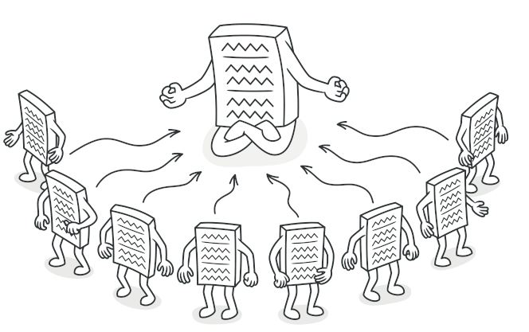

# Singleton

## **Propósito**

**Singleton** es un patrón de diseño creacional que nos permite asegurarnos de que una clase tenga una única instancia, a la vez que proporciona un punto de acceso global a dicha instancia.

## **Problema**

El patrón Singleton resuelve dos problemas al mismo tiempo, vulnerando el *Principio de responsabilidad única*:

1. **Garantizar que una clase tenga una única instancia**. ¿Por qué querría alguien controlar cuántas instancias tiene una clase? El motivo más habitual es controlar el acceso a algún recurso compartido, por ejemplo, una base de datos o un archivo.
2. **Proporcionar un punto de acceso global a dicha instancia**. ¿Recuerdas esas variables globales que utilizaste (bueno, sí, fui yo) para almacenar objetos esenciales? Aunque son muy útiles, también son poco seguras, ya que cualquier código podría sobrescribir el contenido de esas variables y descomponer la aplicación.
    
    Al igual que una variable global, el patrón Singleton nos permite acceder a un objeto desde cualquier parte del programa. No obstante, también evita que otro código sobreescriba esa instancia.
    

## **Solución**

Todas las implementaciones del patrón Singleton tienen estos dos pasos en común:

- Hacer privado el constructor por defecto para evitar que otros objetos utilicen el operador `new` con la clase Singleton.
- Crear un método de creación estático que actúe como constructor. Tras bambalinas, este método invoca al constructor privado para crear un objeto y lo guarda en un campo estático. Las siguientes llamadas a este método devuelven el objeto almacenado en caché.

Si tu código tiene acceso a la clase Singleton, podrá invocar su método estático. De esta manera, cada vez que se invoque este método, siempre se devolverá el mismo objeto.

## **Analogía en el mundo real**

El gobierno es un ejemplo excelente del patrón Singleton. Un país sólo puede tener un gobierno oficial. Independientemente de las identidades personales de los individuos que forman el gobierno, el título “Gobierno de X” es un punto de acceso global que identifica al grupo de personas a cargo.

## **Aplicabilidad**

**Utiliza el patrón Singleton cuando una clase de tu programa tan solo deba tener una instancia disponible para todos los clientes; por ejemplo, un único objeto de base de datos compartido por distintas partes del programa.**

El patrón Singleton deshabilita el resto de las maneras de crear objetos de una clase, excepto el método especial de creación. Este método crea un nuevo objeto, o bien devuelve uno existente si ya ha sido creado.

**Utiliza el patrón Singleton cuando necesites un control más estricto de las variables globales.**

