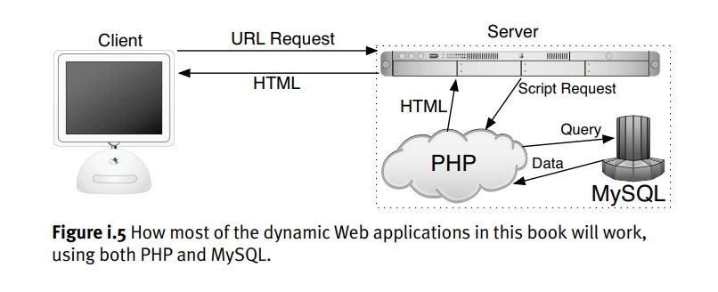

# PHP

**Intro a PHP:**

**<¿php ¿>** para indicar que ingresaremos código php**.**

**Echo** se usa como print.

**$variable** para definir variables dinámicas.

- -**>** es el utilizado para referirse a un método u objeto dentro de un objeto.

Condicional igual a javascript.

El **var_Dump** muestra información estructurada sobre una o más expresiones incluyendo su tipo y valor. Las matrices y los objetos son explorados recursivamente con valores sangrados para mostrar su estructura.

Arrays se hacen de dos formas: como javascript o indicando array().

Arrays asociativos son como los dictionary.

El **pre** se usa como pre-procesador de hipertexto**.**

Podemos usar HTML en PHP o viceversa sin problemas.

For, foreach, While son similares a js.

Funciones para string: **strlen**, **str_word_count**, **strrev**(reverse), **strops**(encontrar string), **str_replace**, **strtolower**, **strtoupper**, **strcmp**(compara bites, 0 si es igual), **strsub** (Substrae cadena desde el numero indicado), **trim** (sustrae espacios en blanco)

**Isset** permite verificar si el dato tiene una variable o valor definido.

**in_array** Checks if a value exists in an array

la diferencia entre **require**() e **include**() es que require se usa cuando es estrictamente necesario que exista el archivo o fragmento. Es más recomendable include.

### Extra:

When it comes time to develop your own PHP projects, remember that you can only use PHP to send information.

Using a client-side technology like JavaScript, you can create a new browser window, add mouseovers, make pop-up alerts, resize the browser window, find out the screen size on the user’s machine, and dynamically generate and alter forms. None of these tasks can be accomplished using PHP.

Javascript -> Client side PHP -> Server Side

